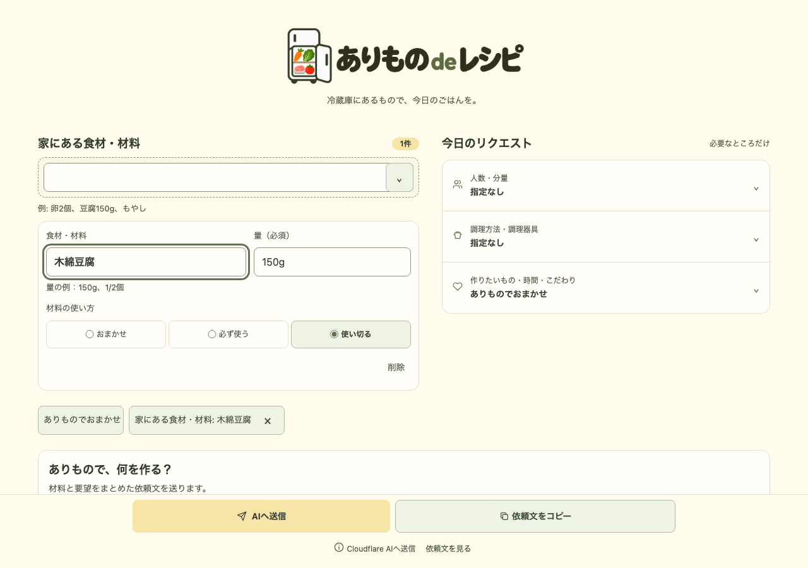

# ありもの de レシピ

家にある食材と「使い切りたい量」から、AIにレシピを相談できるWebアプリです。

**[アプリを使う](https://arimono-de-recipe.pages.dev/)** — 登録不要



## 使い方

1. **食材を入力する**：材料ごとに「おまかせ」「必ず使う」「使い切る」と分量を指定します。
2. **希望を加える**：人数・調理器具・「子ども向け」などの要望を入力します。
3. **「AIへ送信」を押す**：アプリ内でレシピを確認できます。

「依頼文をコピー」で、ChatGPT・Claude・Geminiに貼り付けて相談することもできます。アプリ内AIの利用制限に達したときもコピーできます。

入力は保存されず、再読み込みすると消えます。詳しくは[使い方・データの扱い](docs/usage.md)を参照してください。

## 技術構成

| 用途 | 技術 |
| --- | --- |
| フロントエンド | TypeScript / Vite / HTML / CSS |
| 配信・API | Cloudflare Pages / Pages Functions |
| AI・利用制限 | Workers AI / Groq（任意）/ Cloudflare D1 |
| テスト・品質管理 | Vitest / Playwright / Biome / GitHub Actions |

## 開発

Node.js 22.22以降の22系、または24.8以降を使用します。

```bash
git clone https://github.com/AudioStakes/arimono-de-recipe.git
cd arimono-de-recipe
npm ci
npm run dev
```

この手順では、材料入力と依頼文のコピーを試せます。アプリ内AIの利用には[追加設定](docs/deployment.md)が必要です。

[開発・検証手順](CONTRIBUTING.md) · [設計判断](docs/adr/)

## 問い合わせ・利用条件

不具合・改善案は[Issues](https://github.com/AudioStakes/arimono-de-recipe/issues)、脆弱性の報告は[SECURITY.md](SECURITY.md)へ。

ソースは閲覧用に公開しています。再利用を許諾するライセンスは未設定です（`UNLICENSED`）。
