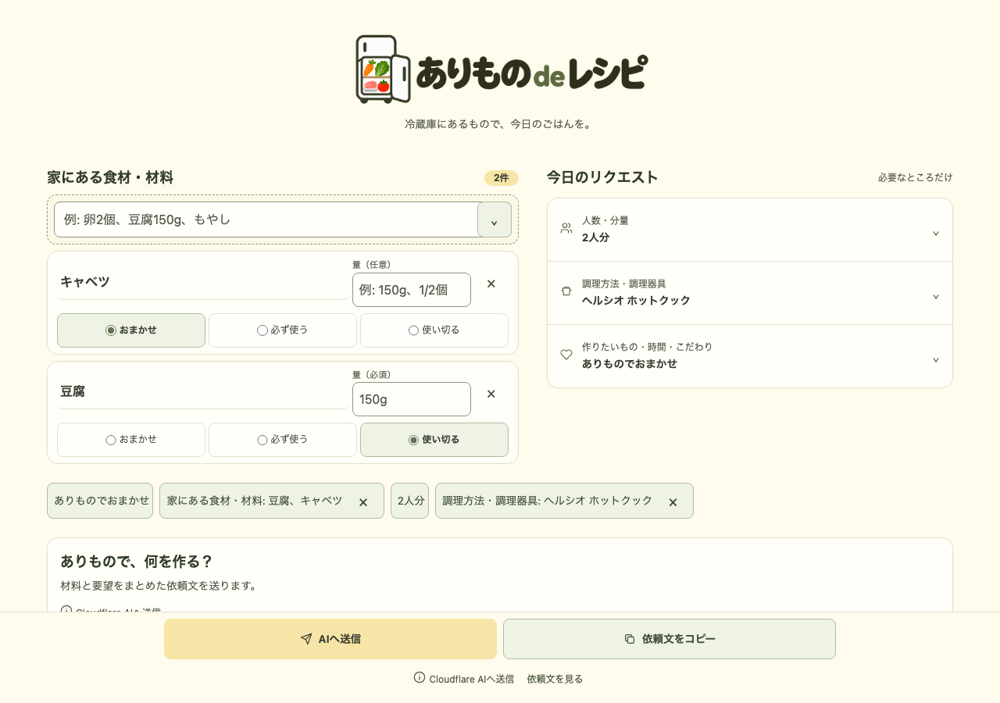

# ありもの de レシピ

**冷蔵庫にあるもので、今日のごはんを。**

家にある食材と「使い切りたい量」を入力して、AIに料理を相談できるWebアプリです。買い足しなしを基本に、入力から作った依頼文をアプリ内AIへ送り、回答をその場で読めます。普段使っているChatGPT・Claude・Gemini向けの依頼文を作ってコピーすることもできます。

[アプリを使う](https://arimono-de-recipe.pages.dev/)



[スマートフォンの画面](docs/media/mobile.png) · [移行前の操作動画](docs/media/demo.mp4)

## 使い方

1. **材料を追加する。** 「豆腐」「キャベツ」など、家にある食材を入力します。
2. **使い方を選ぶ。** 材料ごとに「おまかせ」「必ず使う」「使い切る」と分量を指定できます。人数・調理時間・NG食材も必要な分だけ追加します。
3. **AIへ送信する。** 「AIへ送信」を押すと、依頼文全文をアプリ内AIへ送り、見出し・材料・手順を読みやすいMarkdown表示で確認できます。

別のAIを使う場合は「依頼文をコピー」を押して貼り付けてください。入力条件を整理した日本語の依頼文を作ります。アプリ内AIが利用できないときもコピーできます。

登録は不要です。入力・依頼文の生成・コピーはブラウザ内で行い、入力内容はAIへ送るボタンを押すまで自動送信しません。入力は保存せず、再読み込みすると消えます。本番はCloudflare Web Analyticsでアクセス状況を集計しますが、食材や依頼文を解析へ送りません。フッターの「プライバシー」でデータの扱いを確認できます。AIの回答は参考情報です。調理前に材料・アレルギー・加熱条件を確認してください。[入力上限とデータの扱い](docs/usage.md)

## 技術構成と設計

| 領域 | 採用技術・役割 |
| --- | --- |
| フロントエンド | TypeScript、HTML、CSS、Vite。UIフレームワークを使わず、画面と入力状態を管理 |
| 配信・AI | Cloudflare Pages、Pages Functions、Workers AI。AI送信は同一オリジンの `/api/recipe` に限定 |
| 回答表示 | micromarkと表拡張。raw HTML・外部画像を表示せず、安全なMarkdownを描画 |
| テスト | Vitestで依頼文・入力条件・API契約を検証。Playwrightでブラウザ操作とレスポンシブ表示を確認 |
| 品質管理 | Biome、TypeScript、HTML・Markdown・YAML検査、npm auditをGitHub Actionsで実行 |

依頼文を組み立てる処理と画面描画を分け、項目・候補値を設定データで管理しています。未指定の条件やルールは出力せず、利用者が入力した量や要望を保ちます。表示・コピー・送信で同じ依頼文を使い、待機・失敗時もコピーできます。入力変更による通信の中断や古い回答の破棄も扱います。AIの回答は材料・NG条件の自動照合を行わないため、調理前の確認が必要です。

スマートフォンでは下部の送信・コピー操作とページ内の回答、デスクトップでは材料とリクエストを2カラムに並べ、回答をその下に表示します。キーボード操作、フォーカスの復元、長い入力、コピー拒否、AIの待機・失敗もテスト対象です。設計の理由と制約は[ADR](docs/adr/)、検証範囲は[UXテスト対応表](docs/testing/ux-test-matrix.md)に記録しています。

## ローカルで動かす

Node.js 22.12以上の22系、または24以上とnpmを使います。CIはNode.js 22です。

```bash
npm ci
npx playwright install --with-deps chromium firefox webkit
npm run dev
```

表示されたURLを開くと依頼文の作成・コピーを試せます。アプリ内AIを含める場合は[Cloudflareでの公開手順](docs/deployment.md)を参照してください。

```bash
npm run check  # 整形・lint・型検査・ビルド・unit・structure・E2E
npm run audit:dependencies
npm run build  # dist/ に静的ファイルを出力
```

開発手順は[CONTRIBUTING.md](CONTRIBUTING.md)、検査の担当範囲は[品質ゲート](docs/quality-gates.md)に記載しています。

## 問い合わせ・利用条件

不具合や改善案は[GitHub Issues](https://github.com/AudioStakes/arimono-de-recipe/issues)へ、脆弱性は[非公開の報告手順](SECURITY.md)をご確認ください。

ソースは閲覧用に公開しています。再利用を許諾するライセンスは未設定です（`UNLICENSED`）。
